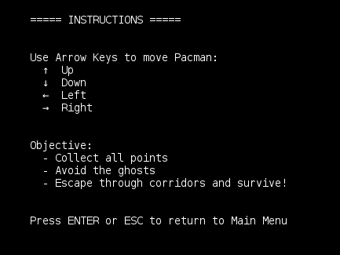
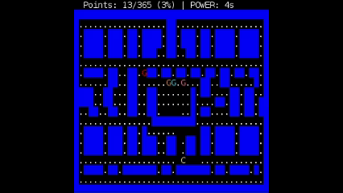
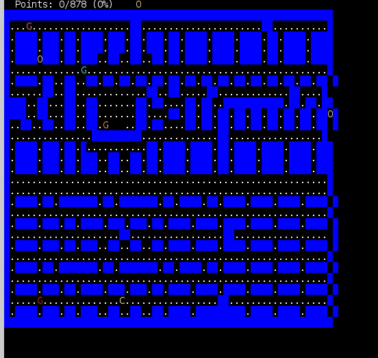
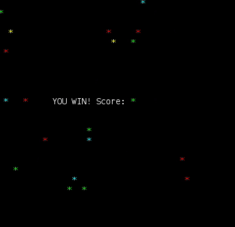
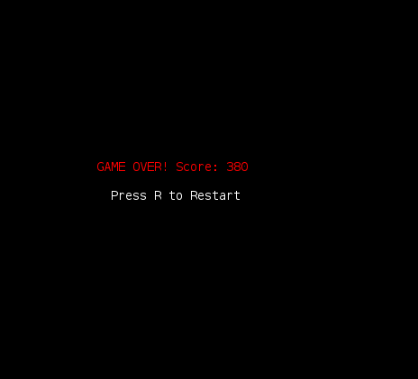
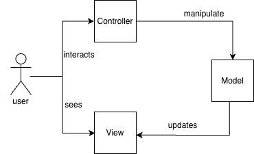
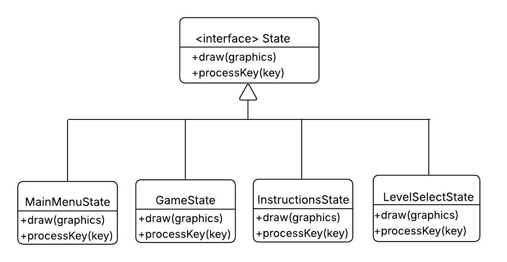
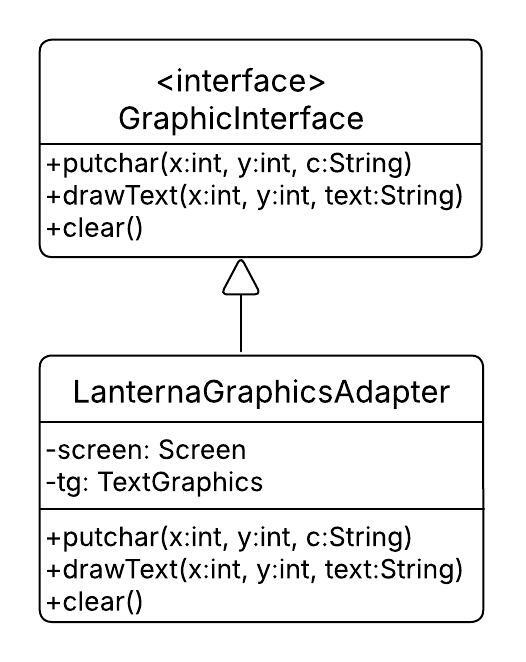
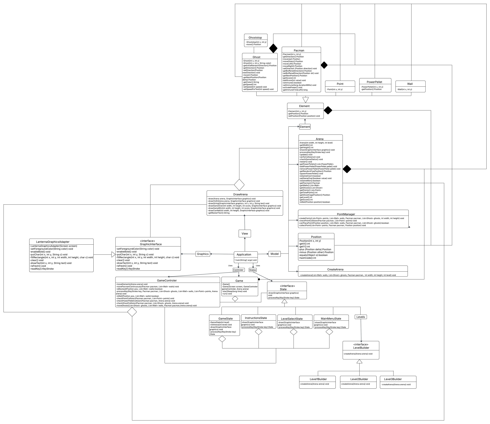

# LDTS_T11_G06 - **PACMAN**
## Game Description
Neste jogo clássico chamado PACMAN, o utilizador controla uma personagem que percorre um labirinto comendo pontos e evitando os fantasmas. O objetivo é limpar o mapa sem ser apanhado pelos fantasmas. Este projeto foi desenvolvido por André Rocha (up202407636@up.pt), Catarina Mendes (up202406155@up.pt) e Rodrigo Monteiro (up202005454@up.pt) para LDTS 2025/2026.

### **Game Demonstration:**
- **Menus:**

  

  <b><i>Fig 1.Main Menu </i></b>

  

  <b><i>Fig 2.Intructions </i></b>

  

  <b><i>Fig 3.Levels Menu </i></b>

- **Levels:**

 

 
 
 

   <b><i>Gif 1.Level 1</i></b>

 

 
 
 

   <b><i>Gif 2.Level 2</i></b>

 

 
 
 

   <b><i>Gif 3.Level 3</i></b>

- **End Game:**

 

 
 
 

   <b><i>Gif 4.Game Won (Nota: quando se ganha o score é máximo neste caso 365)</i></b>

  

  <b><i>Fig 4.Game Over (Nota: O score é dinâmico) </i></b>

 

### Implemented Features
- **Movimento do Personagem:** O utilizador controla o personagem em quatro direções (cima, baixo, esquerda, direita). O Pacman mantém-se em movimento contínuo na direção escolhida, parando apenas quando colide com uma parede.

- **Labirinto:** O mapa é composto por paredes intransponíveis, desenhadas para criar uma navegação estratégica e desafiante para o jogador.

- **Pontos e Score:** A recolha de pontos espalhados pelo mapa aumenta a pontuação do jogador. O nível é concluído quando todos os pontos são consumidos.

- **Fantasmas:** Inimigos percorrem o labirinto de forma contínua. A colisão entre o Pacman e um fantasma resulta no fim do jogo (Game Over), exceto se o Pacman tiver um poder ativo.

- **Poderes (Power Pellets):** Implementação de itens especiais que, quando consumidos, conferem imunidade temporária ao Pacman. Durante este período, o Pacman não morre ao colidir com fantasmas, enviando-os de volta à posição inicial.

- **Níveis Dinâmicos:** O jogo suporta progressão de níveis. Ao completar um mapa, o jogador avança para um novo nível (foram implementados 3 níveis distintos) com layouts diferentes e dificuldade acrescida (aumento da velocidade dos fantasmas).

- **Menus Interativos:** Navegação completa entre Menu Principal, Seleção de Níveis, Instruções e Jogo, permitindo uma experiência de utilizador fluida.

### Planned Features
Por agora, todas as features planeadas foram implementadas.

## Design
### **1. Architectural Pattern (MVC)**
- **Problem in Context:** Num projeto que envolve sistemas interativos complexos, como um jogo, torna-se imperativo estabelecer uma arquitetura estruturada que promova a modularidade e a Separation of Concerns. A ausência de uma organização clara conduziria a um acoplamento excessivo (Spaghetti Code) entre a lógica do jogo, as interações do utilizador e a representação visual, dificultando testes e manutenção.

- **The Pattern:** Implementou-se o padrão Model-View-Controller (MVC). Este padrão divide as responsabilidades em três camadas distintas.

- **Implementation:**

*Model:* Encapsula o estado do sistema e dados (e.g., **Arena**, **Pacman**, **Ghost**). Não tem conhecimento da interface gráfica.

*View:* Responsável apenas pela representação visual (**DrawArena**, **LanternaGraphicsAdapter**). Recebe dados do Model para desenhar, mas não os altera.

*Controller:* Processa as entradas do utilizador e atualiza o Model (**GameControler**). Gere a lógica de colisões e movimento.

- **Consequences:**

- Aderência ao Single Responsibility Principle (SRP).

- Facilidade em testar a lógica do jogo (**Model**) sem depender da biblioteca gráfica (Lanterna).

- Capacidade de alterar a interface gráfica (**View**) sem partir a lógica do jogo.

- **UML diagram:**
  

  

  <b><i>Fig 5. MVC UML</i></b>

### **2. State Pattern**
- **Problem in Context:** O jogo possui comportamentos distintos dependendo do "momento" em que se encontra: Menu Principal, Jogo, Instruções ou Seleção de Níveis. Gerir isto com condicionais complexas (if/else) ou flags booleanas na classe **Game** tornaria o código difícil de escalar e propenso a erros.

- **The Pattern:** Aplicámos o State Pattern para representar os diferentes estados do jogo como objetos.

- **Implementation:** Definiu-se uma interface **State** com métodos para desenhar e processar input. Classes concretas como **MainMenuState**, **GameState**, **InstructionsState** e **LevelSelectState** implementam comportamentos específicos. A classe **Application** e **Game** delegam o comportamento para o estado atual.

- **Consequences:**

- Eliminação de condicionais complexas na classe principal.

- Facilidade em adicionar novos estados (ex: Menu de Pause) sem alterar o código existente (Open/Closed Principle).

- Transições de estado explícitas e controladas.

- **UML diagram:**
  

  

  <b><i>Fig 6. State Pattern UML</i></b>

### **3. Factory Method & Builder Pattern (Level Generation)**
- **Problem in Context:** O jogo requer múltiplos níveis com layouts diferentes e configurações de inimigos variadas. Construir cada nível manualmente dentro da classe Arena violaria o SRP e criaria uma classe rígida e difícil de manter.

- **The Pattern:** Utilizámos uma abordagem baseada em Builder/Factory. Criou-se uma interface **LevelBuilder** que define como uma arena deve ser populada.

- **Implementation:** Classes específicas (Level1Builder, Level2Builder, Level3Builder) implementam a lógica de construção de cada mapa (paredes, posição inicial dos fantasmas e velocidade). A classe **GameState** atua como Director, solicitando ao builder apropriado a criação da arena consoante o nível escolhido.

- **Consequences:**

- Separação completa entre a lógica de construção do nível e a sua utilização.

- Facilidade em criar novos níveis apenas adicionando uma nova classe **Builder**.

- Permite variações complexas (ex: Nível 2 tem fantasmas com velocidade duplicada) de forma encapsulada.

- **UML diagram:**
  

  

  <b><i>Fig 7. Factory Method & Builder Pattern (Level Generation) UML</i></b>

### **4. Adapter Pattern**
- **Problem in Context:** O jogo utiliza a biblioteca Lanterna para a interface gráfica. Depender diretamente das classes concretas do Lanterna (como TextGraphics) em todo o código tornaria impossível testar a lógica de desenho sem abrir uma janela de terminal real, além de acoplar o jogo a uma biblioteca externa específica.

- **The Pattern:** Implementou-se o Adapter Pattern através da interface **GraphicInterface**.

- **Implementation:** A interface GraphicInterface define os métodos que o nosso jogo precisa (drawText, putChar, clear). A classe **LanternaGraphicsAdapter** implementa esta interface e "adapta" as chamadas para a biblioteca Lanterna.

- **Consequences:**

-*Testabilidade:* Permite criar Mocks de **GraphicInterface** para testar as **Views** unitariamente sem interface gráfica real (como demonstrado em DrawArenaTest e LanternaGraphicsAdapterTest).

- *Desacoplamento:* O código do jogo não depende diretamente da implementação do Lanterna.

- **UML diagram:**
  

  

  <b><i>Fig 8. Adapter UML</i></b>

### **5. Game Loop**
- **Problem in Context:** Um jogo precisa de atualizar a lógica e renderizar a imagem a uma taxa constante. Fazer isto sem controlo de tempo resultaria num jogo que corre a velocidades diferentes dependendo da potência do computador, prejudicando a jogabilidade.

- **The Pattern:** Implementou-se o padrão Game Loop na classe **Game**.

- **Implementation:** O método run() gere o ciclo de vida: processar input -> atualizar estado -> desenhar. Utiliza-se controlo de tempo (System.currentTimeMillis()) para garantir que cada frame demora exatamente o tempo definido (FRAME_TIME), mantendo o jogo fluido e consistente.

- **UML diagram:**
  

  

  <b><i>Fig 9. Game Loop UML</i></b>

## UML Schema
  

  

  <b><i>Fig 10.UML classes diagram</i></b>

## Known Code Smells and Refactoring
### *1. Large Class & Single Responsibility Principle*
- **Smell:** Inicialmente, a classe Arena era responsável por guardar os elementos, verificar colisões, mover o Pacman e ainda construir o mapa inicial. Isso tornava a classe enorme e difícil de manter.
  
- **Refactoring:**

- *Extract Class:* A lógica de construção do mapa foi extraída para **CreateArena** e para os **LevelBuilders**.

- *Extract Class:* A lógica de gestão e colisão de pontos foi movida para **PointManager**.

  Agora, a Arena serve principalmente como contentor de dados (**Model**), delegando a lógica complexa para classes especializadas.

### **2. Primitive Obsession**
- **Smell:** O uso de coordenadas soltas (int x, int y) em todos os métodos de desenho e movimento tornava o código propenso a erros (trocar x por y acidentalmente).

  - **Refactoring:** Utilização consistente da classe **Position** para encapsular coordenadas. Isto permite também usar métodos como **position.plus()** ou **position.equals()**, tornando o código mais legível e seguro.

## Testing
A estratégia de testes focou-se em garantir a **robustez da lógica do jogo** e a **prevenção de regressões**, utilizando testes unitários e testes de mutação.

### **Screenshots of Coverage Report**

 

  

  <b><i>Fig 11.Test Coverege Report</i></b>

(Nota: O projeto atingiu uma cobertura de mutação de 80% e cobertura de linha de 92%, o que demonstra uma suite de testes extremamente robusta).

### **Unit Testing & Mocking**
Utilizámos JUnit 5 e Mockito extensivamente.

- **Mocking:** O padrão Adapter permitiu-nos "mockar" a **GraphicInterface** e o **Screen**. Isto possibilitou testar a classe **DrawArena** e garantir que os métodos de desenho (drawCharacter, setForegroundColor) são chamados com os parâmetros corretos, sem precisar de abrir uma janela.

- **Mutation Testing:** Utilizámos o **Pitest** para avaliar a qualidade dos nossos testes. O código foi desenhado para "matar" mutantes, garantindo que verificamos limites de loops, condições lógicas e valores de retorno, como documentado nos comentários dos testes.

### **Testes Principais:**

- **PacmanTest / GhostTest:** Verificam a lógica de movimento, velocidade e atributos dos elementos.

- **ArenaTest:** Garante a integridade do mapa, colisões e regras de vitória/derrota.

- **DrawArenaTest:** Verifica se a View processa corretamente o estado do Model e desenha as cores corretas.

- **GameControlerTest:** Testa o fluxo principal, spawns de PowerPellets e resposta a inputs.

## Self-Evaluation
O trabalho foi dividido de forma equitativa. Todos os membros contribuíram para a arquitetura, implementação de features e testes.

André Rocha: 33.3%
Catarina Mendes: 33.3%
Rodrigo Monteiro: 33.3%
